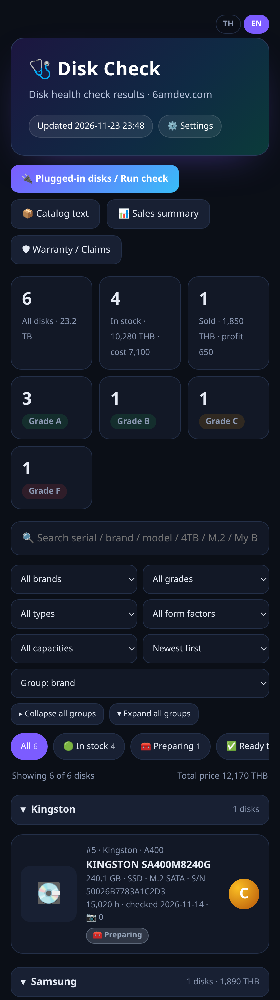
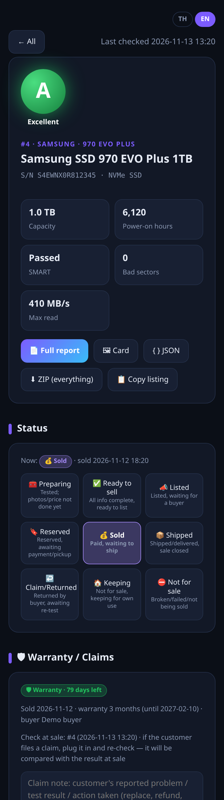
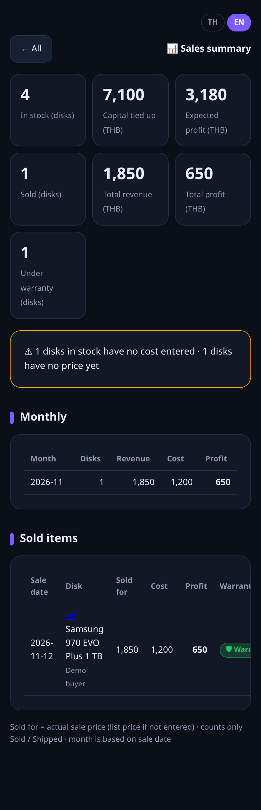
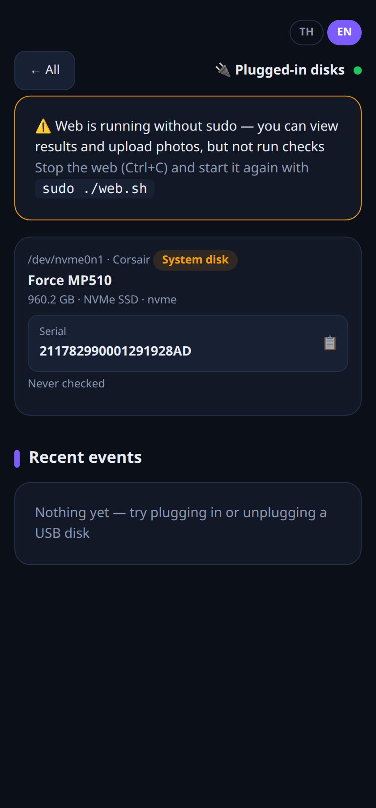
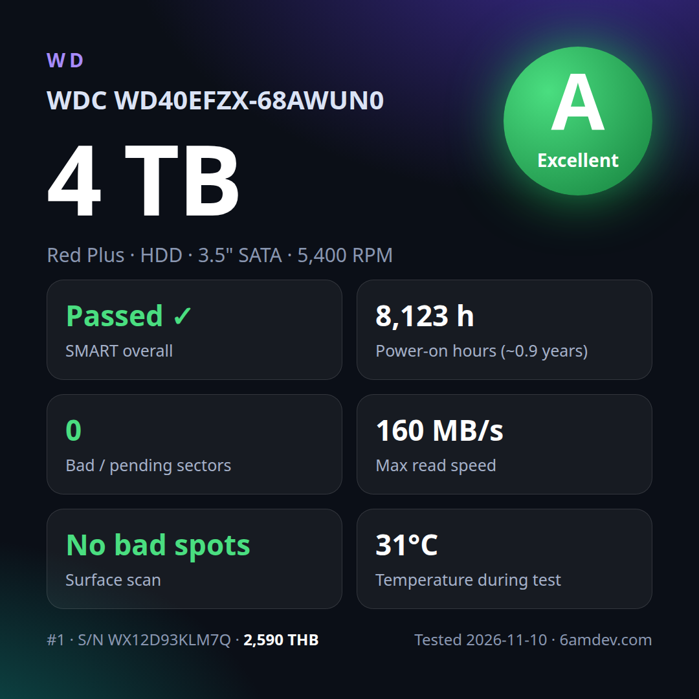

<div align="center">

# 🩺 Disk Check

**Hard-drive health checker + tiny shop manager for people who test and sell used drives.**
Plug a drive in, get a graded health report, photos, ready-to-post sales text, and a phone-friendly web dashboard.

[](#requirements)
[](#requirements)
[](#requirements)
[](#languages)

**English** · [ภาษาไทย](README.th.md)

   



</div>

---

## ✨ Features

**Check** — every test is **read-only**; nothing on the drive is ever written or erased.
- HDD, SATA SSD, NVMe, **M.2 in USB enclosures** and **retail external drives** (WD My Book, Elements, Seagate Expansion, Samsung T7 …)
- SMART (auto-tries USB bridge modes `sat`, `sntrealtek`, `sntjmicron`, `sntasmedia` …), short/long self-test, read speed at 3 zones, random or full surface scan, system log I/O errors
- Brand, series and form factor detection (`Seagate IronWolf`, `M.2 NVMe`, `3.5" SATA`, `WD My Book · inside WD80EMAZ`)
- Simple grade: **A** excellent · **B** good · **C** fair · **F** failing · **?** not enough data

**Keep records** — a built-in SQLite database keyed by serial number.
- Every drive gets a unique number `#1, #2, #3 …`; re-tests are kept as history, the latest one is shown
- Per-drive folder: HTML report, AI-friendly `data.json`, 1080×1080 `card.png`, photos named `SERIAL_1.jpg …`, post texts, ZIP export

**Sell** — a LAN web app you use from your phone (PIN protected).
- Upload photos straight from the phone camera, sale form (price, warranty, shipping …)
- Search everything (`4tb`, `m.2`, `my book`, `grade a`, serial, buyer …), filter, sort and **group by brand / series / model / form / capacity / status / grade**
- 9 sale statuses with one-tap buttons and history (preparing → listed → reserved → sold → shipped → returned …)
- Ready-made texts: Facebook post, Marketplace title/description/price, short post, customer chat reply, status update, catalog of everything in stock, label text with one-tap copy
- **Cost & profit** per drive, monthly sales summary
- **Warranty & claims**: look up by serial, days left, and a side-by-side **"at sale vs now"** test comparison that highlights what got worse
- **Live device page**: plug a drive in and it is detected and checked automatically, with progress on your phone

## 🚀 Quick start

```bash
sudo apt install smartmontools          # required
git clone https://github.com/6amdev/disk-check.git
cd disk-check

sudo ./run.sh                           # interactive menu (terminal)
sudo ./web.sh                           # phone web app on http://<this-pc-ip>:8080
```

The web app prints its address and a PIN. Open it from a phone on the **same Wi-Fi**.
Google Chrome / Chromium is optional (used to render `card.png`).

### Requirements
- Linux (developed on Ubuntu 24.04), Python 3.8+ — **standard library only**, no `pip install`
- `smartmontools`; `sudo` for checking drives (viewing data and the web app work without it)

## 🖥 Terminal usage

```bash
sudo ./run.sh --disk sdb                       # standard check (recommended, 3–5 min)
sudo ./run.sh --disk sdb --quick               # info + SMART only (~10 s)
sudo ./run.sh --disk sdb --full                # + full surface scan (HDD 1 TB ≈ 2–3 h)
sudo ./run.sh --disk sdb --full --selftest long  # most thorough
./run.sh --list | --show 1 | --note 1 "text" | --rebuild [1]
./run.sh --lang en                             # English output
```

| Level | What it does | Time |
|---|---|---|
| Quick | drive info + SMART | ~10 s |
| **Standard** (default) | + short self-test + read speed (3 zones) + 2,000-point random scan | 3–5 min |
| Full | + full surface scan | HDD 1 TB ≈ 2–3 h |
| Max | + long self-test | HDD 4 TB 10 h+ |

`Ctrl+C` during a self-test or scan skips that step and finishes the rest.

## 🌐 Languages

Thai and English are built in. Thai is the source; English lives in [`locales/`](locales/).

| Where | How to switch |
|---|---|
| Web app | **TH / EN** button at the top of every page (remembered per phone) |
| Terminal | `--lang en`, or `"lang": "en"` in `config.json` |
| Reports, cards, post texts | **Settings → Output language** (`"output_lang"`); the disk page can also show post texts in both languages |

Adding a language = add `locales/<code>_*.json` with the same keys and register it in `i18n.py`.

## 📁 What gets created

```
data/diskcheck.db              SQLite database (disks + every test)
disks/0001_SERIAL/
├── report.html                customer-facing report with photos
├── data.json                  full details, easy for AI / your website to read
├── card.png / card.html       1080×1080 image for social posts
├── listing.txt facebook.txt posts.txt
├── photos/SERIAL_1.jpg …
└── tests/test-0001_….json     snapshot of every test
disks/index.html  disks/catalog.txt
reports/                       per-run reports + history.csv
```

Private fields (cost, buyer, real sold price, claims) are stored **only** in the database and never appear in reports, posts, JSON or ZIP exports.

## ⚙️ Configuration — `config.json`

Created automatically on first run (see [`config.example.json`](config.example.json)). Most settings are editable from the web **Settings** page.

| Key | Meaning |
|---|---|
| `shop` | shop name on cards and reports |
| `lang` / `output_lang` | UI language / language of generated files (`th`, `en`) |
| `web_pin` | web login PIN (auto-generated) |
| `fb_hashtags`, `sale_defaults` | post hashtags, default warranty/shipping/payment texts |
| `auto_check`, `auto_level` | auto-check on plug-in and its level |

## 🔒 Privacy & safety
- All tests only **read** from the drive.
- The web app listens on your LAN, behind a PIN. Don't expose it to the internet.
- `data/`, `disks/`, `reports/` and `config.json` are git-ignored — your database, photos and PIN stay on your machine. Back them up yourself.

## 💡 USB tips
- Some USB enclosures hide SMART; the tool tries several bridge modes automatically. If it still can't read, try another enclosure or a direct SATA connection.
- CRC errors usually mean a bad cable/enclosure, not a bad drive.
- Use a USB 3 port; USB 2 caps speed at ~35 MB/s. NVMe behind USB 3.0 (5 Gbps) tops out around 400 MB/s — that's normal.

---

<div align="center">Made for a small used-drive shop · <a href="https://6amdev.com">6amdev.com</a></div>
