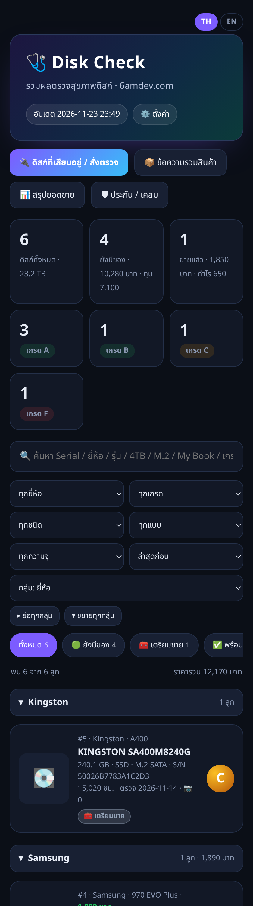
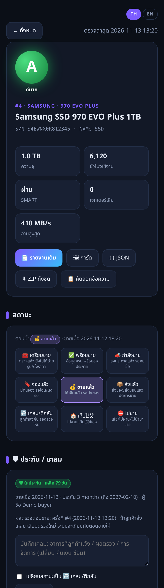
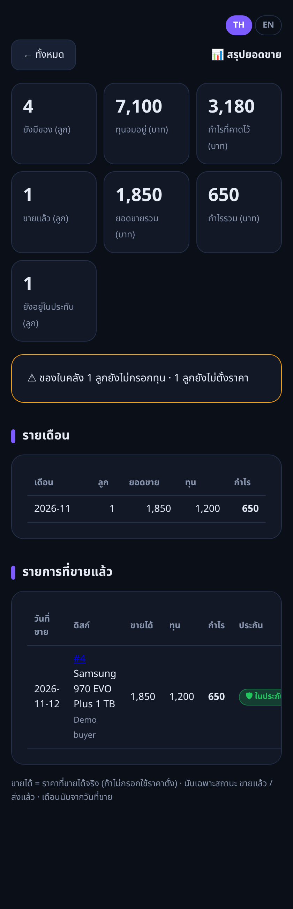
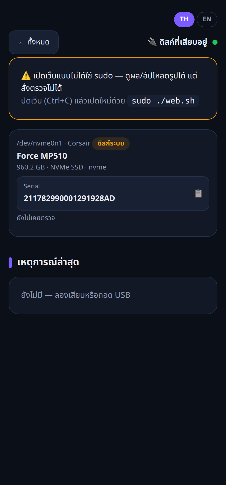
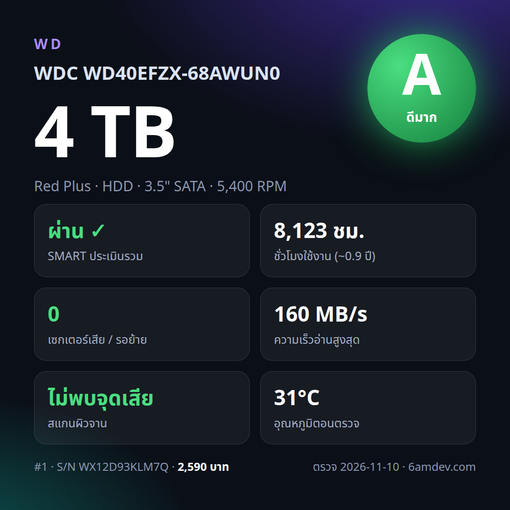

<div align="center">

# 🩺 Disk Check

**ตรวจสุขภาพฮาร์ดดิสก์ + ระบบจัดการขายเล็กๆ สำหรับคนตรวจและขายดิสก์มือสอง**
เสียบดิสก์ → ได้เกรดสุขภาพ รายงาน รูป ข้อความโพสต์ขาย และเว็บจัดการบนมือถือ

[](#ติดตั้งครั้งแรก)
[](#ติดตั้งครั้งแรก)
[](#ติดตั้งครั้งแรก)
[](#ภาษา--languages)
[](LICENSE)

[English](README.md) · **ภาษาไทย**

   



</div>

---

ตรวจสุขภาพฮาร์ดดิสก์ / SSD / NVMe บน Linux ทั้งดิสก์ในเครื่องและดิสก์ที่ต่อผ่าน USB (รวม M.2 และดิสก์ภายนอกสำเร็จรูปอย่าง WD My Book)
รันจบในคำสั่งเดียว บันทึกลงฐานข้อมูลในตัว (ใช้ Serial Number เป็นกุญแจ) และได้โฟลเดอร์ผลตรวจของดิสก์แต่ละลูกพร้อมใช้งาน

**ทุกการทดสอบเป็นแบบอ่านอย่างเดียว** ไม่ลบหรือเขียนทับข้อมูลในดิสก์

## ติดตั้งครั้งแรก

```bash
sudo apt install smartmontools
git clone https://github.com/6amdev/disk-check.git
cd disk-check
```

ใช้ Python 3.8 ขึ้นไป ไลบรารีมาตรฐานล้วน ไม่ต้อง `pip install` อะไรเพิ่ม

ถ้าต้องการให้สร้างรูปการ์ด `card.png` ด้วย ต้องมี Google Chrome หรือ Chromium ในเครื่อง

## วิธีใช้

ต้องรันใน Terminal ของ Ubuntu (Ctrl+Alt+T) ด้วย `sudo`

```bash
sudo ./run.sh                    # เปิดเมนู เลือกดิสก์และระดับการตรวจ
sudo ./run.sh --disk sda         # ตรวจ /dev/sda แบบมาตรฐาน (แนะนำ)
sudo ./run.sh --disk sda --full  # + สแกนผิวจานเต็มทุกเซกเตอร์
sudo ./run.sh --disk sda --full --selftest long   # ละเอียดที่สุด (HDD 4TB ใช้เวลา 10 ชม.ขึ้นไป)
sudo ./run.sh --disk sda --quick # ดูแค่ข้อมูลกับค่า SMART (~10 วินาที)
```

ดูชื่อดิสก์ (sda, sdb, ...) ได้จากเมนู หรือรัน `lsblk`

### ระดับการตรวจ

| ระดับ | ทำอะไรบ้าง | เวลาโดยประมาณ |
|---|---|---|
| เร็ว `--quick` | ข้อมูลดิสก์ + ค่า SMART | ~10 วินาที |
| **มาตรฐาน** (ค่าเริ่มต้น) | + self-test แบบสั้น (รอจนเสร็จ) + วัดความเร็วอ่าน 3 โซน + สุ่มสแกน 2,000 จุด | 3–5 นาที/ลูก |
| ละเอียด `--full` | + สแกนผิวจานเต็มทุกเซกเตอร์ | HDD 1TB ~2–3 ชม. |
| ละเอียดสุด `--full --selftest long` | + self-test แบบยาวในตัวดิสก์ | HDD 4TB 10 ชม.ขึ้นไป |

ระหว่างรอ self-test หรือระหว่างสแกนผิวจาน กด `Ctrl+C` ได้ โปรแกรมจะข้ามขั้นตอนนั้นแล้วทำต่อจนจบ

## ฐานข้อมูลในตัว

ตรวจดิสก์ด้วย sudo แล้วผลจะถูกบันทึกลง `data/diskcheck.db` (SQLite) ให้อัตโนมัติ

- **Serial Number** เป็นกุญแจหลัก ตรวจลูกเดิมซ้ำจะไม่สร้างรายการใหม่
- ดิสก์แต่ละลูกได้**เลขประจำ #1, #2, #3, ...** ไม่ซ้ำกัน ใช้แทน Serial ในคำสั่งได้
- การตรวจแต่ละครั้งได้**เลขที่การตรวจ**ของตัวเอง และเก็บเป็นประวัติทุกครั้ง รายงานจะแสดงผลครั้งล่าสุด
- ถ้าไม่ได้รันด้วย sudo หรืออ่านค่า SMART ไม่ได้ จะไม่บันทึก

### คำสั่งจัดการฐานข้อมูล (ไม่ต้องใช้ sudo)

```bash
./run.sh                       # เมนูหลัก: ตรวจ / ดูรายการ / ประวัติ / สร้างรายงานใหม่ / บันทึก
./run.sh --list                # ดิสก์ทั้งหมด
./run.sh --show 1              # ประวัติการตรวจของดิสก์ #1 (ใส่ Serial แทนเลขก็ได้)
./run.sh --note 1 "ข้อความ"    # ใส่บันทึกให้ดิสก์ #1
./run.sh --rebuild             # สร้างรายงาน/การ์ดใหม่ทุกลูก (เช่น หลังใส่รูป)
./run.sh --rebuild 1           # สร้างใหม่เฉพาะดิสก์ #1
./run.sh --import reports/diskcheck-....json   # นำผลตรวจเก่าเข้าฐานข้อมูล
```

## โฟลเดอร์ของแต่ละดิสก์: `disks/0001_SERIAL/`

```
disks/0001_SERIAL/
├── report.html     รายงานสวยๆ ไฟล์เดียวจบ (ฝังรูปไว้ในไฟล์แล้ว ส่งไฟล์นี้ไฟล์เดียวได้เลย)
├── data.json       รายละเอียดทั้งหมด + ประวัติการตรวจ + คำอธิบาย ให้ AI หรือเว็บอ่านได้ง่าย
├── card.png        รูปการ์ดสรุปผล 1080×1080
├── listing.txt     ข้อความสรุป คัดลอกไปวางได้เลย
├── facebook.txt    ข้อความโพสต์ Facebook (ผลตรวจ + ราคา + ประกัน + แฮชแท็ก)
├── posts.txt       ข้อความสำเร็จรูปทุกแบบในไฟล์เดียว (ดูหัวข้อ "ข้อความสำเร็จรูป")
├── card.html       ต้นฉบับของ card.png
├── photos/         ← ใส่รูปดิสก์ตรงนี้
│   ├── SERIAL_1.jpg
│   └── SERIAL_2.jpg
└── tests/          สำเนาผลตรวจแต่ละครั้ง (JSON)
```

### การใส่รูป

1. ลากรูปชื่ออะไรก็ได้ใส่ใน `photos/` (รองรับ jpg, png, webp)
2. รัน `./run.sh --rebuild`
3. โปรแกรมจะเปลี่ยนชื่อรูปเป็น `SERIAL_1.jpg`, `SERIAL_2.jpg`, ... เรียงตามเวลาของไฟล์ แล้วใส่รูปลงใน `report.html`

รูปที่ตั้งชื่อถูกแบบอยู่แล้วจะไม่ถูกเปลี่ยนชื่อ ถ้ารูปรวมกันใหญ่เกิน 25 MB จะมีคำเตือน เพราะรูปถูกฝังไว้ใน report.html

## เว็บสำหรับมือถือ

```bash
sudo ./web.sh       # เปิดแบบสั่งตรวจดิสก์จากเว็บได้ (แนะนำ) · หยุดด้วย Ctrl+C
./web.sh            # เปิดแบบไม่ใช้ sudo: ดูผล/อัปโหลดรูป/กรอกข้อมูลได้ แต่สั่งตรวจไม่ได้
```

จะขึ้นที่อยู่เว็บ เช่น `http://192.168.1.20:8080` กับรหัส PIN ให้เปิดที่อยู่นี้จากมือถือที่ต่อ **Wi‑Fi วงเดียวกับเครื่องนี้**

- **หน้ารวม** แสดงสถิติ (จำนวนลูก, ความจุรวม, ยังมีของกี่ลูก/มูลค่า, ขายแล้วกี่ลูก/ยอดขาย, จำนวนลูกแต่ละเกรด) และการ์ดของดิสก์ทุกลูก พร้อมราคาและป้ายสถานะ
  - 🔍 **ค้นหาได้ทุกข้อมูล** พิมพ์หลายคำได้ (ต้องตรงทุกคำ): เลข `#3`, Serial, ยี่ห้อ, ซีรีส์, รุ่น, `4TB` หรือ `4 TB`, `HDD`/`SSD`, `เกรด A`, ราคา, firmware, `7200rpm`, สถานะ, บันทึก, สภาพ/ประกัน, ชื่อผู้ซื้อ, `มีรูป`/`ไม่มีรูป`, `มีราคา`/`ไม่มีราคา`, `มีเซกเตอร์เสีย`
  - ตัวกรอง ยี่ห้อ / เกรด / ชนิด / แบบ / ความจุ และเรียงลำดับ (ล่าสุด, เลข #, ราคา, ความจุ, ชม.ใช้งาน, เกรด) พร้อมบอกจำนวนที่พบและราคารวม
  - 🗂 **จัดกลุ่ม** ตาม ยี่ห้อ / ยี่ห้อ › ซีรีส์ / รุ่น / แบบ / ความจุ / ชนิด / สถานะ / เกรด หัวกลุ่มบอกจำนวนลูกและราคารวม แตะหัวกลุ่มเพื่อย่อ/ขยาย หรือกด "ย่อทุกกลุ่ม"
  - **แบบ** ของดิสก์: `M.2 NVMe`, `M.2 SATA`, `mSATA`, `2.5" SATA`, `3.5" SATA` ค้นได้ด้วย `m2`, `m.2`, `nvme`, `sata`
  - 📦 **ดิสก์ภายนอกสำเร็จรูป** (WD My Book, Elements, My Passport, Seagate Expansion, One Touch, Toshiba Canvio, Samsung T7, SanDisk Extreme, LaCie ฯลฯ) จัดเป็นแบบ `External HDD`/`External SSD` และจัดกลุ่ม "รุ่นดิสก์ภายนอก" ได้ ค้นด้วย `mybook`, `expansion`, `external`, `ภายนอก` หรือรุ่นไดรฟ์ข้างใน
  - แท็บสถานะพร้อมจำนวน + แท็บ **🟢 ยังมีของ** (เตรียมขาย/พร้อมขาย/กำลังขาย/จองแล้ว)
  - ตัวกรองจำไว้ใน URL กดเข้าดูดิสก์แล้วกดกลับ ยังอยู่ที่เดิม

- **หน้าดิสก์** มีให้
  - 📷 ถ่ายรูปหรือเลือกรูปแล้วอัปโหลด ระบบย่อรูปให้ก่อนส่ง และตั้งชื่อเป็น `SERIAL_ลำดับ` ให้เอง ลบรูปได้
  - 🔖 **สถานะ** แตะปุ่มเดียวเปลี่ยนได้ (ดูหัวข้อ "สถานะดิสก์") พร้อมประวัติการเปลี่ยน
  - 💰 กรอกข้อมูลการขาย: สถานะ, ราคา, สภาพ, ประกัน, สิ่งที่ได้รับ, การจัดส่ง, การชำระเงิน, ติดต่อ, รายละเอียดเพิ่มเติม
  - 💬 **ข้อความสำเร็จรูป** 8 แบบ กดเลือกแท็บแล้วคัดลอก (ดูหัวข้อ "ข้อความสำเร็จรูป")
  - 📣 โพสต์ Facebook: คัดลอกข้อความ → บันทึกรูป → เปิด Facebook หรือ Marketplace → วางข้อความแล้วแนบรูป
  - 📝 บันทึกส่วนตัว เห็นเฉพาะในเว็บนี้ ไม่ไปอยู่ในรายงานหรือโพสต์
  - 🏷 **ข้อมูลสำหรับพิมพ์ฉลาก** แตะช่องไหนก็คัดลอกได้ทันที: รหัส #, Serial, ยี่ห้อ, ซีรีส์, รุ่น, ความจุ, ชนิด, เกรด, ชั่วโมงใช้งาน, ราคา, วันที่ตรวจ และข้อความฉลากสำเร็จรูป (1 บรรทัด / 3 บรรทัด / Serial + รุ่น)
  - 📄 เปิดรายงานเต็ม การ์ด และ JSON ได้
  - ⬇ **ZIP ทั้งชุด** ดาวน์โหลดรายงาน รูป ข้อความ และ JSON ของลูกนั้นในไฟล์เดียว
- **🔌 ดิสก์ที่เสียบอยู่** (ต้องเปิดด้วย `sudo ./web.sh`) แสดงดิสก์ที่เสียบอยู่ตอนนี้ อัปเดตเองทุก 3 วินาที ถอดลูกเก่า เสียบลูกใหม่ แล้วจะขึ้นเอง
  - บอกว่าลูกไหนเคยตรวจแล้ว (#เลข + เกรด) หรือยังไม่เคยตรวจ และแตะที่ Serial เพื่อคัดลอกได้
  - เลือกระดับการตรวจ (เร็ว / มาตรฐาน / ละเอียด / ละเอียดสุด) แล้วกด ▶ ตรวจ
  - มีหน้าดูความคืบหน้าแบบสด กดยกเลิกได้ และเสร็จแล้วมีปุ่มไปดูผล
  - ตรวจหลายลูกพร้อมกันได้ ลูกละหนึ่งงาน
  - ในหน้าดิสก์มีปุ่ม 🔁 ตรวจใหม่ ขึ้นเมื่อดิสก์ลูกนั้นเสียบอยู่
  - **⚡ ตรวจอัตโนมัติเมื่อเสียบ** (เปิดอยู่เป็นค่าเริ่มต้น) เสียบ USB แล้วรอประมาณ 4 วินาที ระบบจะเริ่มตรวจเองตามระดับที่เลือกไว้ ปิดสวิตช์หรือเปลี่ยนระดับได้ในหน้านี้
    - ไม่ตรวจดิสก์ระบบ
    - ลูกที่เสียบค้างไว้ตั้งแต่ก่อนเปิดเว็บต้องกดตรวจเอง
    - ถ้าถอดระหว่างตรวจ ระบบจะหยุดการตรวจลูกนั้นให้
  - **แถบความคืบหน้าสด** ของทุกลูกอยู่ในหน้ารายการเลย
  - **เหตุการณ์ล่าสุด** (เสียบ / ถอด / เริ่มตรวจ / ตรวจเสร็จพร้อมเกรด) มีแจ้งเตือนเด้งขึ้นและสั่นบนมือถือ
- **⚙️ ตั้งค่า** แก้ชื่อร้าน, แฮชแท็กท้ายโพสต์, PIN และ**ค่าเริ่มต้น**ของข้อมูลการขาย (เช่น ประกัน, การจัดส่ง, ช่องทางติดต่อ) ลูกไหนไม่ได้กรอกช่องนั้นเองจะใช้ค่าเริ่มต้น

ข้อมูลการขายจะไปอยู่ใน report.html, listing.txt, facebook.txt, data.json และราคาจะแสดงบน card.png ด้วย

ถ้ามีหน้าต่างไฟร์วอลล์ถาม หรือมือถือเข้าไม่ได้ ให้รันคำสั่งนี้หนึ่งครั้ง (ต้องใช้ sudo ใน Terminal ของ Ubuntu)

```bash
sudo ufw allow from 192.168.0.0/16 to any port 8080 proto tcp
```

ไม่ต้องเปิดเว็บก็ดูหน้ารวมได้ ที่ไฟล์ `disks/index.html` (อัปเดตเองทุกครั้งที่ตรวจหรือ rebuild)

> เว็บนี้ออกแบบให้ใช้ในวง Wi‑Fi ที่บ้านหรือร้าน อย่าเปิดพอร์ตออกอินเทอร์เน็ต ถ้าเปิดด้วย `sudo` เว็บจะมีสิทธิ์ root ใช้ PIN ที่เดายาก และปิดเว็บเมื่อไม่ได้ใช้
>
> อย่าถอด USB ระหว่างที่กำลังตรวจ ให้กดยกเลิกก่อน


### สถานะดิสก์

ในหน้าดิสก์แต่ละลูก ส่วน **สถานะ** แตะปุ่มเดียวเปลี่ยนได้เลย ระบบบันทึกเวลาและประวัติการเปลี่ยนสถานะให้

| สถานะ | ความหมาย | ในโพสต์/แคตตาล็อก |
|---|---|---|
| 🧰 เตรียมขาย | ตรวจแล้ว ยังไม่ได้ถ่ายรูป/ตั้งราคา | ลงแคตตาล็อก |
| ✅ พร้อมขาย | ข้อมูลครบ พร้อมลงประกาศ (ค่าเริ่มต้น) | ลงแคตตาล็อก |
| 📣 กำลังขาย | ลงประกาศแล้ว รอคนซื้อ | ลงแคตตาล็อก |
| 🔖 จองแล้ว | มีคนจอง รอโอน/นัดรับ | 【จองแล้ว】 |
| 💰 ขายแล้ว | ได้เงินแล้ว รอส่งของ | 【ขายแล้ว】 ไม่ลงแคตตาล็อก |
| 📦 ส่งแล้ว | ส่งมอบแล้ว ปิดการขาย | 【ขายแล้ว】 ไม่ลงแคตตาล็อก |
| ↩️ เคลม/ตีกลับ | ลูกค้าส่งคืน รอตรวจใหม่ | ไม่ลงแคตตาล็อก |
| 🏠 เก็บไว้ใช้ | ไม่ขาย เก็บไว้ใช้เอง | ไม่ลงแคตตาล็อก |
| ⛔ ไม่ขาย | เสีย/ไม่ผ่าน/ไม่นำมาขาย | ไม่ลงแคตตาล็อก |

ในฟอร์มข้อมูลการขายมีส่วน 🔒 **ข้อมูลส่วนตัว**: ต้นทุน, ราคาที่ขายได้จริง, ผู้ซื้อ / ช่องทาง, วันที่ขาย เก็บในฐานข้อมูลอย่างเดียว ไม่ออกไปกับโพสต์ รายงาน การ์ด JSON หรือ ZIP กรอกทุนแล้วจะเห็นกำไรของลูกนั้นทันที

### 📊 สรุปยอดขาย (`/sales`)

- ยังมีของกี่ลูก, ทุนจมอยู่เท่าไร, กำไรที่คาดไว้
- ขายแล้วกี่ลูก, ยอดขายรวม, กำไรรวม และสรุปรายเดือน (นับจากวันที่ขาย)
- รายการที่ขายแล้ว พร้อมทุน กำไร และสถานะประกันของแต่ละลูก
- เตือนเมื่อยังมีลูกที่ไม่ได้กรอกทุนหรือราคา (ลูกที่ไม่มีทุนจะไม่ถูกนับในกำไร)
- ขายได้ = ราคาที่ขายได้จริง (ถ้าไม่กรอกใช้ราคาตั้ง) · นับสถานะ ขายแล้ว / ส่งแล้ว และ เคลม/ตีกลับ ของที่ขายไปแล้ว (ถ้าคืนเงิน ให้เปลี่ยนสถานะเป็น พร้อมขาย หรือ ไม่ขาย)

### 🛡 ประกัน / เคลม (`/claim`)

- **วันเริ่มประกัน** = วันที่ขาย ระบบจดให้เองตอนเปลี่ยนสถานะเป็น ขายแล้ว/ส่งแล้ว แก้เองได้ในช่อง "วันที่ขาย"
- **ระยะประกัน** อ่านจากช่อง "ประกัน" เช่น `30 วัน`, `3 เดือน`, `2 สัปดาห์`, `1 ปี`, `ไม่มีประกัน`
- ลูกที่ขายแล้วมีป้าย "🛡 ในประกัน · เหลือ N วัน" หรือ "หมดประกันแล้ว" ในหน้ารวม ค้นคำว่า `ในประกัน` / `หมดประกัน` / `เคลม` ได้
- **ลูกค้าส่งเคลม:** เปิด 🛡 ประกัน / เคลม → พิมพ์ Serial (บางส่วนก็ได้), #รหัส หรือชื่อผู้ซื้อ → เสียบตรวจใหม่ → หน้าดิสก์จะ **เทียบผลตรวจตอนขายกับล่าสุด** ค่าที่แย่ลงขึ้นสีแดง (เกรด, เซกเตอร์เสีย, pending, uncorrectable, CRC, จุดอ่านไม่ได้, ความเร็วตกเกิน 20%)
- บันทึกเคลมได้หลายครั้ง (อาการ / ผลตรวจ / การจัดการ) และติ๊กให้เปลี่ยนสถานะเป็น ↩️ เคลม/ตีกลับ ได้เลย

## ข้อความสำเร็จรูป

สร้างให้อัตโนมัติทุกลูก ทุกครั้งที่ตรวจหรือแก้ข้อมูลการขาย ใช้ผลตรวจล่าสุด เลือกแบบและกดคัดลอกได้ในหน้าดิสก์บนเว็บ หรือเปิดดูใน `posts.txt`

| แบบ | ใช้ตอนไหน |
|---|---|
| โพสต์ Facebook (เต็ม) | โพสต์ขายในเพจ/โปรไฟล์/กลุ่ม มีผลตรวจครบ + ราคา + ประกัน + แฮชแท็ก |
| Marketplace · หัวข้อสินค้า | ช่อง "หัวข้อ" ใน Marketplace (ไม่เกิน 100 ตัวอักษร) |
| Marketplace · รายละเอียด | ช่อง "คำอธิบาย" ใน Marketplace (ไม่มีแฮชแท็ก) |
| Marketplace · ราคา | ตัวเลขล้วน ใส่ช่องราคา |
| โพสต์สั้น | คอมเมนต์ หรือโพสต์ในกลุ่มที่ไม่ชอบโพสต์ยาว |
| ตอบแชทลูกค้า | ลูกค้าถามว่า "ยังอยู่ไหม" ข้อความเปลี่ยนเองตามสถานะ (พร้อมขาย / จองแล้ว / ขายแล้ว) |
| อัปเดตสถานะ | คอมเมนต์ใต้โพสต์ว่าจองแล้ว / ขายแล้ว / กลับมาว่าง |
| แฮชแท็ก | แฮชแท็กยี่ห้อ ซีรีส์ ความจุ + แฮชแท็กร้านจากหน้าตั้งค่า |

**📦 ข้อความรวมสินค้า** (ปุ่มในหน้าแรกของเว็บ หรือไฟล์ `disks/catalog.txt`) รวมทุกลูกที่ "พร้อมขาย" หรือ "จองแล้ว" พร้อมเกรด ชั่วโมงใช้งาน และราคา ไว้โพสต์รวมในกลุ่ม

## รายงานของการตรวจแต่ละครั้ง: `reports/`

- `diskcheck-*.html` รายงานรวมของการตรวจครั้งนั้น ใช้ดูเอง มีข้อมูลพาร์ทิชันและ log ระบบ
- `diskcheck-*.json` ข้อมูลดิบของการตรวจครั้งนั้น
- `history.csv` ประวัติการตรวจทุกครั้ง ลูกละหนึ่งแถว เปิดด้วย LibreOffice Calc หรือ Excel ได้

## ภาษา / Languages

รองรับ **ไทย** และ **English** (ภาษาไทยเป็นต้นฉบับ คำแปลอยู่ใน [`locales/`](locales/))

| ที่ไหน | เปลี่ยนยังไง |
|---|---|
| เว็บ | ปุ่ม **TH / EN** มุมบนขวาทุกหน้า (จำแยกตามมือถือแต่ละเครื่อง) |
| Terminal | `./run.sh --lang en` หรือใส่ `"lang": "en"` ใน `config.json` |
| รายงาน การ์ด ไฟล์โพสต์ | หน้า ⚙️ ตั้งค่า → ภาษาของรายงาน การ์ด และไฟล์โพสต์ (`"output_lang"`) · ในหน้าดิสก์สลับดูข้อความสำเร็จรูปได้ทั้งสองภาษา |

ข้อมูลที่บันทึกไว้ (สถานะ เกรด ผลตรวจเก่า) แสดงได้ทั้งสองภาษา ไม่ต้องตรวจใหม่

## ตั้งค่า: `config.json`

> `config.json` ไม่อยู่ใน git (มี PIN) — เครื่องใหม่จะสร้างให้เองตอนเปิดเว็บครั้งแรก หรือคัดลอกจาก `config.example.json` ก็ได้ · โฟลเดอร์ `data/`, `disks/`, `reports/` (ฐานข้อมูล รูป รายงาน) ก็ไม่อยู่ใน git ให้สำรองแยกเอง

```json
{
  "shop": "6amdev.com",
  "note": ""
}
```

- `lang` ภาษาเริ่มต้นของเว็บและ terminal (`th` / `en`) · `output_lang` ภาษาของรายงาน การ์ด และไฟล์โพสต์
- `shop` ชื่อที่แสดงบนการ์ดและในรายงาน (แก้แล้วรัน `./run.sh --rebuild` เพื่ออัปเดตทุกลูก)
- `note` ข้อความที่จะต่อท้าย `listing.txt` เช่น เงื่อนไขรับประกัน
- `web_pin` PIN สำหรับเข้าเว็บ (สร้างให้เองตอนเปิดเว็บครั้งแรก)
- `fb_hashtags`, `sale_defaults` แก้ได้จากหน้า ⚙️ ตั้งค่า ในเว็บ
- `auto_check`, `auto_level` เปิด/ปิดการตรวจอัตโนมัติ และระดับที่ใช้ (แก้ได้จากหน้า 🔌 ดิสก์ที่เสียบอยู่)

## ตรวจอะไรบ้าง

| หัวข้อ | รายละเอียด |
|---|---|
| ข้อมูลดิสก์ | ยี่ห้อ + ซีรีส์ (เช่น Seagate IronWolf, WD Red), รุ่น, S/N, firmware, ความจุ, ชนิด, RPM |
| กล่อง USB | ยี่ห้อกล่องหรืออะแดปเตอร์ และความเร็วพอร์ต (เตือนถ้าเสียบ USB 2.0) |
| SMART | ผลประเมินรวม, ชั่วโมงใช้งาน, อุณหภูมิ, เซกเตอร์เสีย/รอย้าย/อ่านไม่ได้, CRC error, error log, อายุ SSD (SATA/NVMe), ค่าที่ต่ำกว่าเกณฑ์ผู้ผลิต |
| Self-test | สั่งให้ดิสก์ทดสอบตัวเอง แล้วรอจนได้ผล |
| ความเร็วอ่าน | วัดที่ต้นจาน กลางจาน และท้ายจาน |
| สแกนผิวจาน | สุ่มอ่าน 2,000 จุด หรือสแกนเต็มทั้งจาน เพื่อหาจุดที่อ่านไม่ได้หรืออ่านช้า |
| พาร์ทิชันและ log | พื้นที่ใช้/ว่าง, I/O error ใน log ระบบ |

## เกรด

| เกรด | ความหมาย |
|---|---|
| **A** ดีมาก | ไม่พบปัญหา ชั่วโมงใช้งานน้อยกว่า 20,000 ชม. |
| **B** ดี | ไม่พบปัญหา แต่ผ่านการใช้งานมาพอสมควร (เกิน 20,000 ชม.) |
| **C** พอใช้ | มีข้อสังเกต เช่น เซกเตอร์เสียที่ย้ายแล้ว 1–9 จุด, CRC error, ใช้งานเกิน 40,000 ชม., ความเร็วต่ำ, ร้อน |
| **F** มีปัญหา | SMART ไม่ผ่าน, เซกเตอร์เสียตั้งแต่ 10 จุด, มีเซกเตอร์รอย้ายหรืออ่านไม่ได้, self-test ไม่ผ่าน หรือสแกนเจอจุดอ่านไม่ได้ |
| **?** | ข้อมูลไม่พอ (ไม่ได้ใช้ sudo หรืออ่านค่า SMART ไม่ได้) |

## เคล็ดลับดิสก์ USB

- **ดิสก์ภายนอกสำเร็จรูป (My Book ฯลฯ):** ระบบรู้จากชื่อสินค้า USB ให้เอง แล้วบันทึกเป็น "รุ่นภายนอก" แยกจากไดรฟ์ข้างใน (เช่น WD My Book · ข้างในเป็น WDC WD80EMAZ) Serial ที่ใช้เป็นกุญแจคือของไดรฟ์ข้างใน ชื่อขายในโพสต์/แคตตาล็อกจะเป็น "WD My Book 8 TB External HDD" ถ้าระบบเดาผิดหรือไม่รู้จัก แก้ได้ที่หน้าดิสก์ ส่วน **ดิสก์ภายนอก** (ปล่อยว่าง = ดิสก์เปล่า) ถ้าแกะไดรฟ์ออกมาตรวจในกล่องทั่วไป ระบบจะเปลี่ยนเป็นดิสก์เปล่าตามผลตรวจล่าสุด
- **M.2 SSD ในกล่อง USB:** ใช้กล่องที่ชิปรองรับ SMART เช่น Realtek RTL9210/9210B, JMicron JMS583, ASMedia ASM2362/2364 ระบบลอง `-d sntrealtek` / `sntjmicron` / `sntasmedia` ให้เอง และรู้ว่าเป็น NVMe จากค่า SMART (กล่อง RTL9210B รับได้ทั้ง M.2 SATA และ NVMe) ถ้าเสียบ USB 3.0 (5Gbps) ความเร็ว NVMe จะตันที่ราว 400 MB/s เป็นเรื่องปกติ

- กล่อง USB บางรุ่นไม่ส่งค่า SMART ออกมา โปรแกรมจะลองหลายวิธีให้เอง ถ้ายังอ่านไม่ได้ให้ลองเปลี่ยนกล่อง หรือต่อ SATA ตรง
- ถ้ามี CRC error มักเกิดจากสายหรือกล่อง ไม่ใช่ตัวดิสก์
- เสียบพอร์ต USB 3.0 (สีฟ้า) ไม่งั้นความเร็วจะตันที่ประมาณ 35 MB/s
- กล่อง USB บางรุ่นสั่ง self-test ไม่ได้ ถ้าเป็นแบบนั้นโปรแกรมจะข้ามขั้นตอนนี้แล้วตรวจส่วนอื่นต่อ

## ความเป็นส่วนตัว

- ทุกการทดสอบ **อ่านอย่างเดียว**
- เว็บเปิดในวง LAN และมี PIN อย่าเปิดออกอินเทอร์เน็ต
- `data/`, `disks/`, `reports/` และ `config.json` ไม่อยู่ใน git — ฐานข้อมูล รูป และ PIN อยู่ในเครื่องเราเท่านั้น สำรองแยกเอง
- ข้อมูลส่วนตัว (ทุน ผู้ซื้อ ราคาที่ขายได้จริง ประวัติเคลม) อยู่ในฐานข้อมูลอย่างเดียว ไม่ออกไปในรายงาน โพสต์ JSON หรือ ZIP

## 📄 สัญญาอนุญาต

[MIT](LICENSE) — ใช้ แก้ไข และแจกต่อได้ฟรี ไม่มีการรับประกันใดๆ

---

<div align="center">ทำขึ้นสำหรับร้านขายดิสก์มือสองเล็กๆ · <a href="https://6amdev.com">6amdev.com</a></div>
